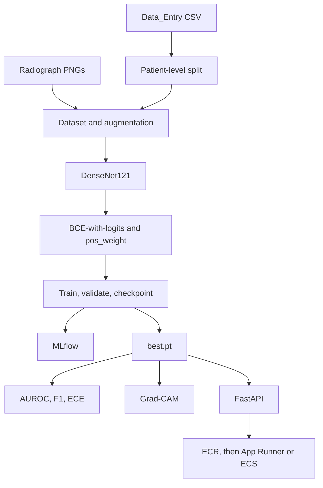

# Chest X-ray triage

[](https://github.com/SomkeneA/chest-xray-triage/actions/workflows/ci.yml)

Config-driven PyTorch pipeline for multi-label triage of frontal chest radiographs on [NIH ChestX-ray14](https://nihcc.app.box.com/v/ChestXray-NIHCC): 112,120 images from 30,805 patients, 14 text-mined findings. The code trains a DenseNet121 from ImageNet weights, scores AUROC, sensitivity, specificity, F1, and calibration, writes Grad-CAM overlays, tracks runs in MLflow, and serves probabilities from a Dockerized FastAPI app.

This repository is a starter. The training and evaluation path runs end to end on a synthetic fixture. A full NIH training run has not been recorded here yet. The Results section is empty on purpose.

> **Not for diagnostic use.** This software is not a medical device and must not be used for diagnosis, screening, or clinical decision-making. ChestX-ray14 labels were mined from reports and are noisy. A probability and a Grad-CAM overlay are not a radiology read.

## What it does

- Loads `Data_Entry_2017.csv` and the radiograph PNGs, including the official header that contains unquoted commas.
- Assigns every patient to train, validation, or test. Follow-up studies cannot land in two splits. The official NIH list files do not make that guarantee, so this project does not use them.
- Augments training images with a mild crop, horizontal flip, small rotation, and narrow contrast jitter. Validation and test images are resized and center-cropped. Both paths use ImageNet normalization.
- Trains a 14-logit DenseNet121 with `BCEWithLogitsLoss`. Class imbalance is handled with a per-label `pos_weight` of `n_negative / n_positive` on the training split, capped so a rare finding such as hernia cannot dominate.
- Selects the checkpoint by mean validation AUROC (validation loss if a split has only one class for every label), writes `best.pt` and `last.pt`, and can log parameters, the weight vector, and per-epoch metrics to a local MLflow store.
- Reports per-label and macro AUROC, sensitivity, specificity, and F1 at a fixed threshold or at thresholds chosen on validation to maximize F1. Calibration is expected calibration error plus a reliability diagram per finding.
- Builds a Grad-CAM heatmap from the last spatial map in the DenseNet (`features.norm5`).
- Serves `GET /health`, `GET /ready`, and `POST /predict`. The predict response is one probability per finding and, if requested, a base64 Grad-CAM PNG.

## Architecture



The 14 findings, in model order, are Atelectasis, Cardiomegaly, Effusion, Infiltration, Mass, Nodule, Pneumonia, Pneumothorax, Consolidation, Edema, Emphysema, Fibrosis, Pleural_Thickening, and Hernia. `No Finding` is the all-zero vector. Labels are not mutually exclusive.

## Project structure

```
configs/                 default.yaml for NIH, smoke.yaml for the synthetic fixture
docker/entrypoint.sh     optional MODEL_URL download, then uvicorn
src/cxr_triage/
  config.py              YAML loader; unknown keys are errors
  labels.py              the 14 findings and the clinical disclaimer
  data/                  CSV loader, patient splits, dataset, NIH download
  models/                DenseNet121 and checkpoints
  training/              pos_weight, the loop, MLflow
  evaluation/            AUROC, operating points, ECE, reliability diagrams
  explainability/        Grad-CAM
  api/                   FastAPI app
tests/fixtures/synthetic fake radiographs and a tiny Data_Entry CSV
```

## Setup

Python 3.10 or newer. Commands assume the repository root. CPU wheels are the default so a laptop and CI do not pull the multi-gigabyte CUDA build. On a GPU machine, install a CUDA build of PyTorch that matches the driver before `pip install -e ".[dev]"`.

```bash
python -m venv .venv
source .venv/bin/activate
make install
make test
```

`make install` installs CPU PyTorch first, then this package. Pip's default "only if needed" behavior leaves that CPU build in place.

Without Make:

```bash
python -m pip install torch torchvision --index-url https://download.pytorch.org/whl/cpu
python -m pip install -e ".[dev]"
ruff check . && ruff format --check .
pytest
```

Check that the loop runs before downloading anything:

```bash
make smoke
```

That is one epoch on 12 synthetic PNGs. MLflow writes a local SQLite file at `mlruns/mlflow.db`, and weights go under `./checkpoints`. Both are gitignored. The fixture is drawn shapes, not NIH data, and the epoch does not produce a number worth reporting.

## Data

ChestX-ray14 is distributed by the NIH Clinical Center: <https://nihcc.app.box.com/v/ChestXray-NIHCC>. There is no account required. The release is about 45 GB. Do not commit the CSV, the archives, or the PNGs. `data/` is gitignored except for a placeholder file.

1. Download `Data_Entry_2017.csv` from that folder and save it as `data/Data_Entry_2017.csv`. The image archives do not contain the labels.
2. Download and unpack the 12 image archives:

```bash
make download
# equivalent:
python -m cxr_triage.data.download --output-dir data
```

The script uses the batch URLs published with the NIH Box release, streams each `images_00N.tar.gz` into `data/archives`, and writes PNGs into `data/images` using the file basename (`Image Index`). `--dry-run` prints the plan and does not download. `--only 1,2` fetches a subset. `--delete-archives` removes each archive after extraction. If a URL no longer returns a gzip file, the script stops and points back at the Box folder.

Already-downloaded zips or tarballs, including a Kaggle unpack of `nih-chest-xrays/data`, can be flattened without a new download:

```bash
python -m cxr_triage.data.download --from-dir /path/to/local/archives --output-dir data
```

The Kaggle CSV uses clearer column names. The loader accepts those and the original NIH header.

Other copies, if the Box links are inconvenient: the [Google Cloud public dataset](https://docs.cloud.google.com/healthcare-api/docs/resources/public-datasets/nih-chest) (`gs://gcs-public-data--healthcare-nih-chest-xray`) and the [Academic Torrents mirror](https://academictorrents.com/details/557481faacd824c83fbf57dcf7b6da9383b3235a). After either one, the files this repo expects are:

```
data/Data_Entry_2017.csv
data/images/00000001_000.png
data/images/...
```

A full CSV has 112,120 rows and 30,805 patients. The loader warns when the counts differ and still trains on a subset. `data.drop_missing: true` skips rows whose PNG is absent.

Dataset terms ask for three things: link the NIH download page, cite Wang et al., and acknowledge the NIH Clinical Center as the provider. See [Citation](#citation).

## Train

```bash
make train
# python -m cxr_triage.training.train --config configs/default.yaml
```

`configs/default.yaml` is a starting point, not a claim about the best setup: ImageNet initialization, AdamW at `1e-4`, cosine decay, batch size 32, 224 px, dropout 0.1, ten epochs, early stopping after three epochs without a better validation score. Lower the batch size if the GPU runs out of memory. `train.device: auto` uses a GPU when one is visible and otherwise CPU. `amp` turns on only for CUDA.

`split_strategy: patient_stratified` still splits by patient. Inside that, patients with at least one finding and patients whose studies are all `No Finding` are divided with the same ratios, so a small validation split is less likely to be all normal or all abnormal. It does not balance every rare label. Set `patient` for an unstratified patient shuffle. The seed is `seed` in the YAML. The same patient id is never written into two splits; training checks that and raises if it happens.

MLflow writes to `mlruns/mlflow.db` (SQLite). Open it with `mlflow ui --backend-store-uri sqlite:///mlruns/mlflow.db`.

Checkpoints land in `checkpoints/best.pt` and `checkpoints/last.pt`. They store the weights, label order, image size, dropout, the config, and the `pos_weight` vector. They are not committed.

## Evaluate

```bash
make eval
# python -m cxr_triage.evaluation.evaluate \
#   --config configs/default.yaml \
#   --checkpoint checkpoints/best.pt \
#   --split test
```

Use the same seed, ratios, and split strategy as training. The command rebuilds the patient split, runs the checkpoint, and writes:

- `outputs/eval/metrics.json` with per-label and macro AUROC, sensitivity, specificity, F1, and ECE
- `outputs/eval/per_label.csv`
- `outputs/eval/reliability.png`

AUROC is omitted for a label that is all positive or all negative in that split, and the macro average skips those labels. Sensitivity and F1 are omitted when the label has no positives. Specificity is omitted when it has no negatives. The default threshold is 0.5 for every finding. Set `eval.threshold: best_f1` to choose a threshold per label on the validation split and then report the test split. Fitting those thresholds on the test split would make the test score optimistic; the command warns if you do that.

## Grad-CAM

```bash
make gradcam IMAGE=path/to/radiograph.png LABEL=Cardiomegaly
# python -m cxr_triage.explainability.gradcam \
#   --checkpoint checkpoints/best.pt \
#   --image path/to/radiograph.png \
#   --label Cardiomegaly \
#   --output outputs/gradcam.png
```

The overlay is a review aid. It is not a segmentation and it is not evidence that the finding is present.

## Serve

```bash
export MODEL_PATH=checkpoints/best.pt
export CXR_DEVICE=cpu   # or auto, or cuda
make serve
```

```bash
curl -s localhost:8000/health
curl -s -F "file=@tests/fixtures/synthetic/images/00000001_000.png" \
  "localhost:8000/predict?gradcam=true&label=Cardiomegaly"
```

`/health` returns 200 even when no checkpoint is mounted, so a container health check does not restart the task while weights are still being fetched. `/ready` and `/predict` return 503 until `MODEL_PATH` points at a real file. `/predict` returns 14 probabilities in label order, the disclaimer, and an optional base64 PNG. Uploads larger than 20 MB are rejected. The service does not log image bytes.

Docker, still CPU by default:

```bash
docker compose up --build
```

Compose mounts `./checkpoints` at `/models` read-only and sets `MODEL_PATH=/models/best.pt`. With an empty checkpoints directory the API stays up and predict returns 503.

## AWS

No credentials, account ids, or buckets are stored in this repo. The image is stateless apart from the checkpoint it reads.

Build and push to ECR from a machine that is already authenticated:

```bash
aws ecr create-repository --repository-name chest-xray-triage
aws ecr get-login-password --region "$AWS_REGION" \
  | docker login --username AWS --password-stdin \
    "$AWS_ACCOUNT_ID.dkr.ecr.$AWS_REGION.amazonaws.com"
docker build -t chest-xray-triage .
docker tag chest-xray-triage:latest \
  "$AWS_ACCOUNT_ID.dkr.ecr.$AWS_REGION.amazonaws.com/chest-xray-triage:latest"
docker push \
  "$AWS_ACCOUNT_ID.dkr.ecr.$AWS_REGION.amazonaws.com/chest-xray-triage:latest"
```

**App Runner** is the smaller path. Create a service from the private ECR image, port 8000, health check path `/health`. Set `MODEL_PATH=/models/best.pt`. Put `best.pt` in S3 and pass `MODEL_URL` as an HTTPS or pre-signed URL. The entrypoint downloads that URL on start when the file is not already there. A private object needs a pre-signed URL or some other URL that already grants access; the image does not contain the AWS CLI or keys. Give the service on the order of 2 GB of memory for CPU inference of this DenseNet. Confirm with `/ready` after the file lands.

**ECS Fargate** uses the same image. A small task is 1 vCPU and 2–4 GB, port 8000, container health check `GET /health`. Use an application load balancer if you want a stable URL. The same `MODEL_URL` entrypoint applies, or mount the checkpoint from EFS. Prefer `/ready` for a deployment gate and `/health` for "the process is up."

Do not put the service on the public internet without authentication. Do not log radiographs. Do not describe the endpoint as a clinical tool. NIH images are de-identified research data; a deployment that accepts other people's films is a different privacy problem and is out of scope here.

The published image is the CPU build. A GPU service needs a CUDA base image and a matching PyTorch install. Change the Dockerfile deliberately rather than expecting this image to see a GPU.

## Tests and CI

`pytest` covers patient leakage, the NIH CSV header, label encoding, `pos_weight`, AUROC and ECE on fixed arrays, Grad-CAM's shape and range, checkpoint reload, the FastAPI contract, archive unpacking, and one real training plus evaluation pass on the synthetic fixture. GitHub Actions runs `make install`, `make lint`, and `make test` on Python 3.11. Nothing in CI downloads ChestX-ray14 or ImageNet weights.

## Results

**TBD.** No NIH test metrics have been produced from this repository yet. The table is a placeholder for the owner to fill after the first real training run. Do not replace a cell with a number from a paper, a blog, or another codebase.

| Metric | Test split |
| --- | --- |
| Mean AUROC | TBD |
| Mean sensitivity | TBD |
| Mean specificity | TBD |
| Mean F1 | TBD |
| Mean ECE | TBD |

Per-label rows, the threshold used for each finding, the reliability diagram, the checkpoint name, and the MLflow run id belong here as well. Until then, this section is not a result.

## Next steps

The pipeline is implemented and tested on synthetic images. What is left is the owner's:

1. **Download the data.** Put `Data_Entry_2017.csv` in `data/` and run `make download`. The images are about 45 GB and stay out of git.
2. **Run the first training on a GPU.** Use `configs/default.yaml` with `train.device: cuda` (or `auto` on a GPU machine) and run `make train`. Watch validation AUROC in MLflow before launching a longer run. The checked-in hyperparameters are a starting point.
3. **Fill in results.** Run `make eval` on the held-out test split and replace the TBD table above with those numbers only. Keep the per-label table next to it.
4. **Deploy.** Build the image, push it to ECR, and run it on App Runner or ECS Fargate using the notes above. Load the checkpoint with `MODEL_PATH` or `MODEL_URL`. Do not commit the weights.

After those four, reasonable follow-ups are per-label iterative stratification, thresholds chosen for a sensitivity target rather than max F1, and a check on an external collection. None of that is required to start.

## Citation

If you use ChestX-ray14, cite the dataset paper and name the provider:

```
Xiaosong Wang, Yifan Peng, Le Lu, Zhiyong Lu, Mohammadhadi Bagheri, Ronald M. Summers.
ChestX-ray8: Hospital-scale Chest X-ray Database and Benchmarks on Weakly-Supervised
Classification and Localization of Common Thorax Diseases.
IEEE CVPR 2017, pp. 3462-3471.
```

Data provider: NIH Clinical Center. Download page: <https://nihcc.app.box.com/v/ChestXray-NIHCC>.

The DenseNet121 transfer setup used for this kind of label set is the one popularized by CheXNet (Rajpurkar et al., 2017). This repo does not report their numbers.

## License

[MIT](LICENSE). The NIH data has its own terms, summarized above. The synthetic fixture in `tests/fixtures` is generated by this repo and is not a clinical image.
